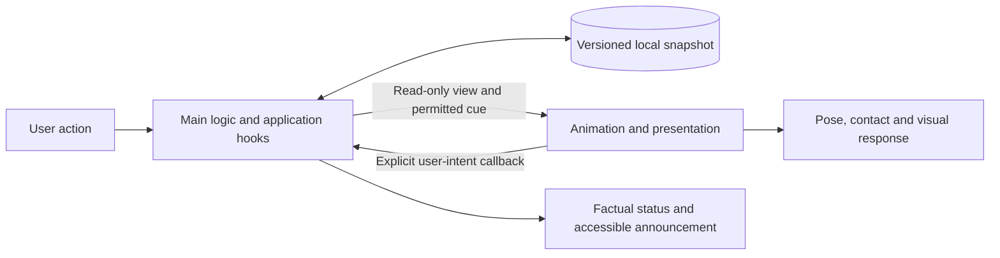

# Focus App: Next Implementation Plan (Review Draft)

Updated: 2026-10-29. This plan describes the next work from the current code baseline and awaits user review. It is not a new PRD revision or a claim that the planned features already exist. This update splits the work into animation and main logic; it changes documentation only, not the source-code structure. Maintain this plan and active project documentation in English; the app's launch language remains a separate product decision.

## 1. Sources and current baseline

- Requirements: the supplied [PRD v3, file revision 7](docs/handoff-20261029/番茄钟_产品PRD_v3.md), especially sections 3–10 and 12–14. Its appendix describes older code, so it must not be treated as the current implementation. The PRD body takes precedence over conflicting appendix descriptions.
- Subsequent user choice: friendly, cute animation with “a soft, round blue creature with expressive little arms.” Continue this prototype direction. The final name, brand icons, material and individual gestures remain open.
- Implementation baseline: `e6daa66`, containing the complete handoff source and blue companion integration. On 2026-10-29 the user requested committing and pushing this implementation together with the English workstream plans. A fresh fetch found remote main at `0a57d03` with no divergent commits. This publication covers the current prototype, not the unfinished P0 plan; deployment results are tracked in [GitHub Actions](https://github.com/Hughstudy/clock/actions).
- Handoff source baseline: `57ca8697cfa3a694f5e319e00d8dc4ee38b4c907`. Preserve the original PRD and [collaboration register snapshot](docs/handoff-20261029/番茄钟_开发协作.md) as historical references. Do not overwrite the cloud register or turn this plan into a duplicate cross-window ownership board.
- Existing evidence: the [friendly companion verification report](docs/verification/friendly-companion.md). That implementation passed strict type checks, 193 tests, a `/clock/` production build, and desktop Chromium checks at phone widths, including offline reopening. Branch statements in that report describe its original verification point; the current Git baseline is above. Application tests were not rerun for this documentation update.

## 2. Current differences from the PRD

| Capability | Implemented now | Remaining work | PRD reference |
| --- | --- | --- | --- |
| F1: timing and accounting | Deadline timing, pause/resume, actual short and zero-second records, freely available rest, expiry reconciliation before actions, separate participation and full-completion counts; optional small step, remembered one-off length and factual end summary (L1, branch `claude/main-logic-l0-l2`) | First-use “Start with 5 minutes” hierarchy remains a review proposal | Sections 4, 10 |
| Supportive feedback | Saved start/pause/resume/end/rest events; requested encouragement with next/dismiss; no replay on recovery or synchronization | Welcome/return and F2/F3 events; requested-encouragement categories; bookmarks; saved event-encouragement preference | Section 7 |
| Blue companion | Original rough.js artwork, seven semantic poses, finite wave/rebound/ending gestures, quiet focus, saved animation preference | Contact with real UI elements, local deformation and cancellable choreography; final artwork and icons | Section 8 |
| F2: thought capture | One-tap empty marker, optional text, persisted draft, session association, put-away, deletion with undo and cross-tab conflict rules (L2, branch `claude/main-logic-l0-l2`) | Announcement policy for delete/undo results; broader browsing in L3 | Section 5 |
| F3: records | Actual-time totals and a basic history list | Day-grouped records, proposed 7/30-day views, inline details, thoughts/collections modes and position preservation | Section 6 |
| Rewards | One participation record per new session and an encouragement library | Visible session mementos that can be revisited, welcome content, bookmarks, permanent content and deduplication; mechanics require review | Section 7 |
| Persistence | Snapshot v4, v1–v3 migration, Web Locks, pending-save retries, merging within a dataset generation, thought revision/deletion-marker conflict rules | Reward/bookmark model, JSON backup, replacement restore and clear-all | Section 10 |
| Settings and delivery | Duration/sound/motion controls, two primary destinations, auxiliary Settings, static PWA and GitHub Pages configuration | Clear invalid-input recovery, encouragement/memento preferences, data management; complete physical-device, installation and accessibility acceptance | Sections 9, 12 |

One experience issue deserves early attention: after a successful ending, encouragement hides the factual status containing the actual duration, while Home displays the next ready timer. Accounting is correct, but the user cannot immediately see how much time was just recorded. Present the factual result separately from encouragement within the existing scene.

## 3. Product goal and scope

Complete a coherent phone journey: **start a small session → pause or capture a thought whenever needed → end with actual time recorded → rest or continue → revisit experiences, thoughts and favorites → back up and restore local data.** The blue companion has its own playful personality throughout. Users never need to work to keep it happy or take care of it.

Deliver through the existing static Web/PWA application and GitHub Pages. Retain React 18, TypeScript, Vite, Strict Mode, rough.js, localStorage and the pure-logic/adapter/hook boundaries. Reuse the reliable timer core. No backend, accounts or cloud synchronization are included.

P0 includes F1, F2, F3, the complete basic reward experience and preferences, backup/replacement restore/clear-all, reliable local data and phone usability. Encouragement and a participation counter alone do not complete the reward system or P0.

Month/arbitrary-date filtering, individual focus-record deletion, CSV, backup merging and hiding seconds remain P1. Native applications, stores and commercialization require separate decisions. Exclude task trees, AI chat, growth/hunger/mood decay, streak pressure, multiple characters and decoration shops.

## 4. Concrete proposals for this review

These are recommendations, not individually approved decisions. Continue the selected round blue creature instead of reopening unrelated character directions.

| Decision | Recommendation | Status and tradeoff |
| --- | --- | --- |
| Character personality | Curious and playful, with expressive little arms; communicate through silhouette, weight and purposeful contact | Extends the user's choice. Review the specific silhouette and gestures in the next prototype; no fixed name or ocean setting |
| Page structure | Keep Focus and Records as the two primary destinations, with Settings as a third, occasional surface; at most one local panel open | Reuse the current structure and validate the complete set of states |
| Lightweight start | First-use primary action: “Start with 5 minutes.” Reveal 5/15/25 choices on demand; later show the user's last explicit selection clearly | A PRD proposal for review. A one-off choice does not silently change the 25/5/15 defaults |
| Ending experience | Show actual session time, its memento and one response in the same scene; prioritize rest, with another session secondary | Treat early and deadline endings equally. Never auto-start the next session or hide facts behind encouragement |
| Sound and motion | New users start quietly; preserve existing sound choices. Use static poses whenever the OS or app requests reduced motion | Default silence is a proposal. Reuse the existing saved animation setting and OS precedence |
| Physical interaction | Start with option A: stationary controls with surfaces that react to contact. Nudge an edge on start, put away a saved thought, lean against the timer during rest | Compare B, coordinated scene interaction, and C, actual control movement, using the same task. No physics engine or freely draggable world is needed initially |
| Records | Default to the last 7 days, switchable to 30; one range total, collapsed trend and day-grouped list; thoughts and collections in the same page | A PRD structure proposal. Thoughts and collections are not restricted to the 7-day window |
| Reward format | One original illustration style showing the companion's everyday life: small session mementos attached to real records; welcome content, bookmarked phrases and a few permanent illustrations in Collections | Review acquisition, saving and later viewing together. No separate reward room or claim step |
| Permanent rewards | Prepare three illustrations in a consistent style; use 3/8/20 distinct sessions only as candidate review parameters | Quantity, thresholds and whether to use cumulative unlocking are unapproved. The initial design review (A1/L0) must settle the rule before production implementation; these numbers are not scientific guidance |

For session mementos, propose retaining the current participation rule: one per newly started logical session, with equal treatment for zero-second and fully elapsed sessions. This is separate from permanent-content unlocking. Hiding mementos must not stop accounting or remove rewards. If cumulative unlocking is rejected, define the alternative way permanent content becomes available and update the milestones rather than silently dropping that part of reward design.

## 5. Two independent workstreams

The remaining work is split into two plans. These define responsibilities and deliverables, not a new live assignment board. Existing files stay in place until an implementation change justifies moving them.

| Workstream | Owns | Does not own | Detailed plan |
| --- | --- | --- | --- |
| Animation | Character art/poses, deterministic geometry, motion timing, contact anchors, visual deformation, responsive scene components, static/reduced-motion presentation, reward artwork and visual inspection | Timer transitions, saving, statistics, note lifecycle, reward eligibility, bookmarks, feedback eligibility or persistent settings | [Animation Plan](docs/plans/ANIMATION_PLAN.md) |
| Main logic | F1/F2/F3, model/storage/migration, settings, reward and bookmark rules, backup/restore/clear, semantic feedback and accessible functional screens, app/PWA integration | Character geometry, gesture choreography, animation scheduling or local deformation algorithms | [Main Logic Plan](docs/plans/MAIN_LOGIC_PLAN.md) |

Main logic owns the meaning and saved result of an action. Animation owns how that result looks. For example, main logic saves a thought and decides whether a fresh success cue is allowed; animation uses that cue to make the creature put it away. If animation is disabled, the same thought is saved and the factual result stays visible.

This is a responsibility split across the existing architecture. Pure drawing/pose functions remain DOM-free in `src/logic/`; DOM measurement, OS motion preferences and scheduling remain in appropriate adapters/hooks. Do not move all animation into components or put all browser effects into pure main logic.

### Ownership at the boundary

- Main owns `src/contracts/`, `src/App.tsx`, functional screens/controls, root composition and `src/styles/focus.css`. Animation provides visual components and scoped styles; main integrates them and supplies stable target anchors.
- Main owns `feedback.ts`, `feedback-host.ts`, `useFeedback.ts`, encouragement content/selection, save/error messages and the single announcement owner. These responsibilities stay in main even where a current folder is named `companion`.
- Animation owns the display-only mapping in `companion.ts`, deterministic artwork in `blue-companion.ts`, `BlueCompanion.tsx`, `useBlueCompanion.ts`, `useCompanionView.ts`, the motion preference hook/OS adapter and its specific art/config/style files. It maps permitted cues to poses without deciding whether a reward or save occurred.
- Main retains `CompanionFeedback.tsx` because it renders factual status, semantic actions and accessibility output. Animation supplies its character slot and visual styling through the reviewed contract.
- Main persists motion/display preferences; animation reads the supplied preference and OS setting. Main saves reward ownership and selects content IDs; animation supplies validated artwork for those IDs. No competing stores, settings controllers or ledgers.
- Changes to shared contracts are integrated by main and reviewed by both workstreams before either side depends on them. A cross-boundary edit goes through the file owner instead of parallel changes to the same path.

## 6. Interface between main logic and animation

Branch `claude/main-logic-l0-l2` implements the first version as `C2-P1` in `src/contracts/presentation.ts`. It provides a read-only `CompanionView`, a `PresentationCue` whose identity is separate from the announcement, and `CompanionCallbacks`, together with fixtures generated from the real logic in `presentation-fixtures.ts`. Contact anchors and reward content IDs are not yet covered. The table below remains the target; see [the verification report](docs/verification/main-logic-l0-l2.md).

| Contract element | Producer and content | Consumer rule |
| --- | --- | --- |
| Read-only view | Main supplies phase/status, true time/progress, factual persistence/error state, selected content IDs and presentation preferences; only the data needed by the renderer | Render the latest state. No access to mutable snapshots or storage and no recalculation of elapsed time/reward eligibility |
| Transient visual cue | Main validates the operation identity, generation/revision, origin and persistence, then supplies a stable cue identity and allowed semantic result | One permitted gesture at most. Renderer may cancel or omit it; doing so has no effect on accounting or saved content |
| Scene inputs | Main's layout exposes stable target refs/anchors; animation measures and coordinates contact within its UI hooks | No DOM measurements in pure logic. Adapt to resize/keyboard changes; cancel safely if a target is absent or moves |
| User callbacks | Main supplies explicit request/next/dismiss/bookmark or other approved controls | Dispatch only on real user intent. Touching a button in a character animation must not dispatch a click |
| Accessibility output | Main selects factual messages, announcement identity and priority; native controls keep accessible names and focus | Animation adds no duplicate live announcements. Reduced motion retains a useful static expression and all semantic controls |
| Local completion/cancellation | Animation clears only its own transient motion state | `animationend`, timeouts and cancellation must never save, grant rewards, start/end sessions or enable a waiting business action |

### Event rules and independent verification

- Snapshot state and transient cues are separate. Countdown refreshes update readings but never generate a new gesture, phrase, reward or drawing seed.
- Main suppresses stale, duplicate, rejected and no-op outcomes. Recovery, synchronization and navigation update state silently; opening a screen does not replay past success.
- Save-dependent success requires confirmed persistence. Pending, memory-only, read-only and failed states remain truthful. A later successful retry uses the original operation identity and can produce at most one eligible success cue.
- Explicit requests for encouragement do not require a data write. Bookmark/save success does. Distinguish the two rather than gating every visual event on persistence.
- Main decides error priority and which cues may be shown. Animation can suppress motion for reduced motion, hidden/unmounted screens, input stability or missing anchors, but cannot upgrade an ineligible result into success.
- Give visual cues an identity independent of screen-reader announcement identity. Main owns durable reward/notification deduplication; animation owns only transient gesture consumption. Do not persist animation replay queues.
- Rapid operations, errors, navigation, backgrounding, generation changes and reduced motion cancel stale choreography. Latest state wins; no delayed playback queue and no waiting for a gesture before the next action.
- Publish fixtures for ready/running/paused/resting, early/full/zero endings, empty/text thought saves, requested encouragement, pending/failure/retry, restore/sync, stale IDs and reduced motion. Animation can develop against fixtures; main must pass the same functional outcomes with a static or absent renderer.

## 7. Parallel sequence and integration gates

The earlier M1–M6 sequence is replaced by the following two workstreams. Scope and acceptance obligations are retained in their detailed plans; the split does not approve open visual or reward proposals.

| Stage | Animation deliverable | Main-logic deliverable | Dependency / review result |
| --- | --- | --- | --- |
| 1. Define the boundary and experience | A1: character states, contact storyboards and coherent reward samples | L0: shared view/cue/callback contract, fixtures, behavior and reward decisions | Review the first experience and publish the contract together; final art polish does not block unrelated business work |
| 2. Build independently | A2: cancellable contact runtime and visual components using fixtures | L1: F1 and schema foundation; then L2: reliable thought capture | Both proceed after the contract. Each can be verified without the other's unfinished implementation |
| 3. Connect real results | A3: replace fixtures at integration points with real views/cues; inspect contact and static modes | L3: history, approved rewards, bookmarks and preferences; integrate the available A2 components | Success cues follow actual saves. Main retains screen semantics and accessibility ownership |
| 4. Complete the release candidate | A4: complete phone/motion evidence for A3’s integrated scenes and approved assets | L4: backup/restore/clear; L5: complete application, phone and PWA checks | Run the full journey together. No release claim without actual implementation and recorded evidence |

For traceability, previous M1 maps to A1/L0; M2 to L1 plus the L0 contracts; M3 to L2; M4 to L3 and A2/A3 assets; M5 to L4; M6 to A4/L5. There is one application and one release candidate, not separate animation and timer products.

Review boundaries are product choices and concrete deliverables. Once a workstream's scope and contract are agreed, routine technical decisions within it do not require repeated permission. New code should use `codex/` feature branches; this documentation change does not create or claim implementation branches.

## 8. Shared acceptance and handoff

- Preserve React 18/strict TypeScript/Vite, deterministic domain functions, deadline timing, short Web Locks, truthful persistence states, stable calendar dates and existing migrations. Neither workstream may weaken these for presentation convenience.
- Each source path has one implementation owner. Publish contract changes before consumers adopt them; include referenceable commits, changed paths, fixtures, actual checks and unresolved items in handoffs. Use the applicable live register for actual multi-window assignments if that workflow resumes.
- Main's functional acceptance must pass with motion disabled or the character renderer replaced by a static placeholder. Animation acceptance must pass using contract fixtures without a live timer or real persistence.
- Combined verification covers rapid actions, save failures/retry, closed-tab expiry, duplicate events, stale tabs, deletion/restore, responsive anchors, focus, reduced motion and offline availability. An animated celebration is never evidence of a successful save.
- For application changes, run relevant tests, `npm run check`, `BASE_PATH=/clock/ npm run build`, then affected production-browser flows and console inspection. Pure geometry/domain checks remain DOM-free. Documentation-only work requires content, link and diff checks, not application tests.
- Inspect 320/375/430 widths, 200% text, landscape/safe areas, soft keyboard, stable touch targets, real screen readers and blocked audio. Record actual versions; iPhone/Android browsers and installed modes require separate evidence. Unavailable device checks stay explicitly unverified.
- Keep `/clock/` asset/manifest/service-worker paths correct. Never force-update an active or paused session, use the worker as a persistent alarm, or clear progress with caches. Branding changes preserve namespaces or supply a migration.
- Publish a reviewable release candidate only after both workstreams' required checks and integrated acceptance. Pushing main deploys; follow the user's actual release instruction separately.

## 9. Current review status and next step

This is an English documentation split for review, not a source-code refactor. The next product deliverables are A1's character/contact/reward samples and L0's shared contract with explicit fixtures. Subsequent visual work and core functionality can then proceed in parallel.

- [x] Handoff source, F1 foundation and blue companion committed to local main (`e6daa66`).
- [x] PRD-to-code gaps and unapproved proposals documented in English.
- [x] Animation and main-logic plans separated, with ownership, interface, dependencies and acceptance criteria.
- [ ] User review of the split and proposed product choices.
- [ ] A1/L0 experience review and shared interface published in code. (L0 `C2-P1` contract and fixtures implemented on `claude/main-logic-l0-l2`; A1 review pending.)
- [ ] A2 fixture-driven animation components.
- [ ] L1/L2 F1, data foundation and thought lifecycle. (Implemented and locally verified on `claude/main-logic-l0-l2`; awaiting review/merge. Device, screen-reader and offline checks are still open.)
- [ ] L3 records, approved rewards, bookmarks and preferences.
- [ ] A3 real-result integration and approved artwork.
- [ ] A4 animation, accessibility and device acceptance.
- [ ] L4 complete backup/restore/clear.
- [ ] L5 integrated phone/PWA release candidate.
- [x] User authorized committing and pushing the current implementation and planning documents on 2026-10-29.
- [ ] Full P0 release after implementation, verification and the relevant release instruction.
