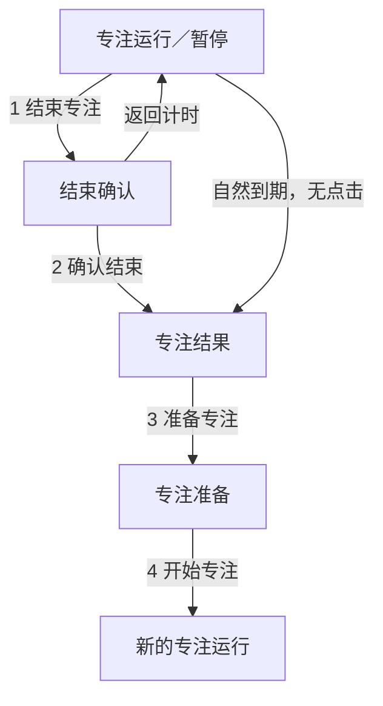
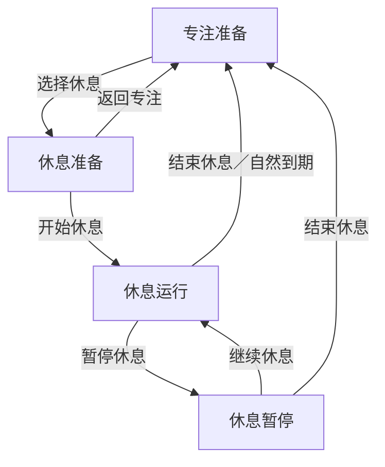

# 专注、休息与时间选择：现状操作全图

> [返回文档地图](README.md) · [交互研究与候选方案](22-timer-interaction-research.md) · 2026-11-22
>
> **这是当前实现的说明，不是改版方案。** 先看第2节的重点路径，再按第3—8节查完整操作。应用代码基线为 [b132621](https://github.com/Hughstudy/clock/commit/b132621d8dc090600270a94f25531d972b6b0fd9)，之后的研究稿提交未修改应用。

## 1. 范围与点击计算方法

覆盖专注、短休息、长休息的准备、开始、暂停、继续、提前结束、自然到期、选择时长、修改默认值，以及切页、面板、重开和异常对这些路径的影响。想法和记录本身的全部编辑功能不在本图中展开，只记录它们如何影响回到计时操作的步骤。

“所有动态线”通过**全部基础状态、可用动作和组合路径**表达。暂停后继续、打开再取消等动作可以无限重复，不把它们的所有排列逐一抄成新流程。

### 1.1 默认起点

除非另写，流程从用户已经在专注页、操作卡已展开、没有其他面板遮挡、数据可写、没有在途计时操作开始。打开App、等待时间流逝、动画和保存等待不算点击，但相关负担会单独说明。

“点击”指一次明确激活一个可见控件。手机触摸与鼠标点击采用相同的流程计数；滑动、输入、按键另列，不伪装成零成本。

### 1.2 可复用的三段操作

| 记号 | 完整操作 | 如何计数 |
| --- | --- | --- |
| D：修改准备中的专注时长 | 点大时间／铅笔 → 选分钟数 → 点“用这个时长” | **2次固定点击＋选值操作**。滑尺法为2次点击＋滑动；输入法为3次点击＋文字输入（含点输入框） |
| R：更换短／长休息类型 | 点“休息时长”下拉框 → 选短休息或长休息 → 如系统要求，再完成原生选择器 | 通常为打开、选择两次激活；手机原生控件可能还有完成动作，统一记为R，不把所有设备写死为2次 |
| G：更改一个默认分钟数 | 点设置 → 修改对应默认值 → 关闭设置，回到专注 | **2次固定点击＋改值操作**。加减法额外每分钟1次；输入法额外点输入框1次＋选择／替换文字。合法输入在失焦时提交，没有单独的保存按钮 |

D只改变准备值，不启动计时；G会改变长期默认值，不能称作单次调时。D、G都以正常合法输入和保存成功为前提，错误分支见第8节。

例：从准备状态用输入法选10分钟并开始专注，依次点时间、点输入框、输入10、点“用这个时长”、点“开始专注”，是**4次点击＋输入**。若用滑尺，则是**3次点击＋滑动**。若目标刻度正好可直接点中，则选值本身另计1次点击。

### 1.3 额外操作从哪里来

| 起点的额外情况 | 在主流程前增加什么 |
| --- | --- |
| 运行中操作卡已经收起 | 点卡片露出的边缘／把手，或空白房间，先呼出操作卡：通常＋1次；摸伙伴不会呼出 |
| 当前在记录页且没有详情遮挡 | 点底部“专注”：＋1次；回来时是否还需呼出卡片取决于当时可见状态 |
| 当前有想法等模态面板 | 先关闭／返回面板，通常＋1次；存在草稿冲突时还要处理该任务，不能直接套固定总数 |
| 当前在设置 | 先关闭设置：＋1次；若当前动作就是G的一部分，则不重复计算 |
| 连续暂停／继续多次 | 每次暂停1次、每次继续1次，逐次累加 |
| 有非法输入、保存失败或状态已经变更 | 走第8节的对应分支，不继续把正常路径次数当作保证 |

## 2. 最值得先看的用户动态线

### 2.1 用户还在做事，想结束这一段后马上再专注

| 步骤 | 用户做什么 | 屏幕与计时发生什么 | 是否已经开始下一段 |
| --- | --- | --- | --- |
| 起点 | 当前专注运行中，或已经暂停 | 时间显示剩余量；有暂停／继续与结束按钮 | 否 |
| 1 | 点“结束专注” | 打开“结束本次专注？”确认框。运行中的计时仍继续；原来暂停则仍暂停 | 否 |
| 2 | 点“确认结束” | 原段按实际计时结束；进入专注结果。大时间显示本段实际时长；主按钮是“开始休息”，次按钮是“准备专注” | 否 |
| 3 | 点“准备专注” | 清掉当前结果展示，回到专注准备；大时间改为下一段准备时长 | 否 |
| 4 | 点“开始专注” | 创建新的专注，开始倒计时 | **是** |

因此，同一条路线从不同起点看，会得到不同数字：**从正在专注算4次；从结束确认框已打开算3次；从专注结果算2次。** 这不是在否定“三次太多”的体验，而是把评审基线固定下来。

这里有两次只改变界面、不开始下一段的动作：打开结束确认、进入专注准备；另有一次真正结束旧段和一次真正开始新段。

### 2.2 用户还要修改下一段时长

以当前运行25分钟专注、希望下一段改为10分钟为例，使用输入框的完整路径如下。

| 步骤 | 用户做什么 | 结果 |
| --- | --- | --- |
| 1 | 点“结束专注” | 打开结束确认，原计时尚未结束 |
| 2 | 点“确认结束” | 原段结束，看到实际计时结果 |
| 3 | 点“准备专注” | 回到下一段专注准备，时间现在才可编辑 |
| 4 | 点时间数字／铅笔 | 打开“调专注时长” |
| 5 | 点分钟数输入框 | 选中现有数字，手机通常唤起键盘 |
| 输入 | 输入10 | 只改变选择器里的草稿，尚未开始 |
| 6 | 点“用这个时长” | 关闭选择器，准备时间变成10:00，仍未开始 |
| 7 | 点“开始专注” | 新建10分钟专注并开始 |

**输入法路径是7次点击＋输入；滑尺路径是6次点击＋滑动。** 若开始时操作卡已收起，再加1次呼出。数字本身需要几次键盘操作、是否需要额外收键盘，随设备而异，未藏进“7次”里。

如果真正目标只是“保持同一段，从现在再做10分钟”，当前没有对应动作。上述路线只是结束后另开一段的绕行；两段记录、两次开始，与原段内调整不是同一个结果。

### 2.3 专注与休息衔接的对照

| 用户目标与起点 | 依次操作 | 基础次数／额外动作 | 到达状态 |
| --- | --- | --- | --- |
| 专注中，提前转休息，沿用当前休息长度 | 结束专注 → 确认结束 → 开始休息 | 3次 | 休息运行 |
| 专注中，提前转另一种休息 | 结束专注 → 确认结束 → R → 开始休息 | 3次＋R | 所选短／长休息运行 |
| 专注中，提前休息8分钟；当前短休息默认5分钟 | 结束专注 → 确认结束 → 设置 → 短休息“＋”3次 → 关闭设置 → 开始休息 | 8次；同时把短休息默认改成8分钟 | 休息运行 |
| 专注中，提前休息8分钟，改用输入框 | 结束专注 → 确认结束 → G（短休息填8）→ 开始休息 | 6次点击＋选择／输入文字；同时改变默认 | 休息运行 |
| 专注自然到期后，沿用建议休息 | 开始休息 | 1次 | 休息运行 |
| 专注自然到期后，直接再专注 | 准备专注 → 开始专注 | 2次 | 新的专注运行 |
| 专注自然到期后，改时长再专注 | 准备专注 → D → 开始专注 | 4次固定点击＋选值；输入法为5次点击＋输入 | 新的专注运行 |
| 休息中，提前回去专注 | 结束休息 → 开始专注 | 2次，没有休息结束确认 | 新的专注运行 |
| 休息中，改下一段专注时长再开始 | 结束休息 → D → 开始专注 | 4次固定点击＋选值；输入法为5次点击＋输入 | 新的专注运行 |
| 休息自然到期后，开始专注 | 开始专注 | 1次 | 新的专注运行 |
| 休息自然到期后，改时间再开始 | D → 开始专注 | 3次固定点击＋选值；输入法为4次点击＋输入 | 新的专注运行 |

8分钟休息示例假设当前选择的是短休息。若已经选择长休息，需改对应默认值或另外执行R，不能混算。

### 2.4 一整个循环有多少操作

从一段已在运行的专注开始，走过一次休息，直到下一段专注已经开始。以下均不改时长、不切休息类型，不计中途呼出卡片。

| 专注怎样结束 | 休息怎样结束 | 点击顺序 | 合计 |
| --- | --- | --- | ---: |
| 提前结束 | 提前结束 | 结束专注 → 确认结束 → 开始休息 → 结束休息 → 开始专注 | 5 |
| 提前结束 | 自然到期 | 结束专注 → 确认结束 → 开始休息；休息到点后点开始专注 | 4 |
| 自然到期 | 提前结束 | 开始休息 → 结束休息 → 开始专注 | 3 |
| 自然到期 | 自然到期 | 开始休息；休息到点后点开始专注 | 2 |

若要改下一段专注长度，另加D；要改休息分钟数，另加G；选不同休息类型另加R。两次运行过程中卡片都可能收起，分别呼出时分别增加点击。

## 3. 屏幕状态清单：此刻能做什么

| 状态 | 用户看到的时间 | 主要操作 | 次级计时操作 | 能否就地改分钟数 |
| --- | --- | --- | --- | --- |
| P：专注准备 | 下一段专注长度，例如25:00 | 开始专注 | 选择休息 | **能**，点时间／铅笔 |
| Q：休息准备 | 所选短／长休息长度，例如05:00 | 开始休息 | 返回专注；选择短／长休息 | **不能**直接自定义，只能切类型或去设置 |
| F：专注运行 | 原段剩余时间 | 暂停专注 | 结束专注，先打开确认 | 不能 |
| FP：专注暂停 | 暂停时的剩余时间 | 继续专注 | 结束专注，先打开确认 | 不能；暂停不会解锁调时 |
| X：专注结果 | 已结束原段的实际计时，形如“8分钟” | 开始休息 | 准备专注；选择短／长休息 | 当前大时间是结果，不能编辑；需先准备专注 |
| R：休息运行 | 原休息剩余时间 | 暂停休息 | 结束休息，直接执行 | 不能 |
| RP：休息暂停 | 暂停时的剩余时间 | 继续休息 | 结束休息，直接执行 | 不能 |
| Y：休息结束后的专注准备 | 下一段专注长度；另有本次休息时长说明 | 开始专注 | 选择休息 | **能**，动作与P相同 |

短休息和长休息共享Q／R／RP的操作结构，取值和范围不同。X在手动结束与自然到期后基本共用，但只有自然到期增加完整到期次数，并可触发长休息建议。

结束确认、调时、设置、想法等是叠在这些状态上的临时任务；打开它们本身不等于计时状态变化。卡片收起也是显示变化，不是暂停。

## 4. 准备和开始的全部基础路径

| 编号 | 用户目标 | 起点 | 点击／操作顺序 | 结果与业务变化 | 次数 |
| --- | --- | --- | --- | --- | --- |
| P01 | 直接开始当前准备长度 | P／Y | 开始专注 | 创建一段专注并记一次参与 | 1 |
| P02 | 改本次专注长度再开始 | P／Y | D → 开始专注 | 新段使用所选长度；不改设置默认 | 3次固定＋选值 |
| P03 | 只选好时间，暂不开始 | P／Y | D | 留在准备，不新增会话或参与 | 2次固定＋选值 |
| P04 | 打开调时后反悔 | P／Y | 点时间 → 取消 | 回到原准备值，不开始 | 2；中途选值另计 |
| P05 | 不专注，先按当前短／长长度休息 | P／Y | 选择休息 → 开始休息 | 先到Q，再建立休息；不记专注参与 | 2 |
| P06 | 先选另一种休息再开始 | P／Y | 选择休息 → R → 开始休息 | 建立所选类型休息 | 2＋R |
| P07 | 选休息后又决定先工作 | P／Y | 选择休息 → 返回专注 → 开始专注 | 在真正开始前来回选择不会创建记录 | 3 |
| P08 | 休息准备已打开，开始休息 | Q | 开始休息 | 新建休息 | 1 |
| P09 | 休息准备已打开，回去专注 | Q | 返回专注 → 开始专注 | 返回准备后才开始专注 | 2 |
| P10 | 休息准备已打开，改下一次专注长度 | Q | 返回专注 → D → 开始专注 | 新建所选长度专注 | 4次固定＋选值 |
| P11 | 按不同的具体分钟数休息 | Q | G（对应休息默认）→ 开始休息 | 改默认并开始；不是单次设置 | 3次固定＋改值 |
| P12 | 休息类型从短改长，但暂不开始 | Q | R | 只改准备选择，不开始休息 | R |

如果用户已经做过P03，再点“开始专注”只需1次；不能把同一段D重复计入。准备中的专注选择在当前访问内切页回来可保留，真正开始成功后才成为后续沿用的专注长度。

## 5. 正在专注、暂停和专注结果的基础路径

| 编号 | 用户目标 | 起点 | 点击／操作顺序 | 结果与业务变化 | 次数 |
| --- | --- | --- | --- | --- | --- |
| F01 | 暂时停表，稍后接着做 | F | 暂停专注 | 到FP，保留原会话与剩余量 | 1 |
| F02 | 接着原段做 | FP | 继续专注 | 回F，不新建一段、不新增参与 | 1 |
| F03 | 暂停一会儿再继续 | F | 暂停专注 → 继续专注 | 暂停期间不计入实际投入 | 2 |
| F04 | 只结束，不开始其他计时 | F／FP | 结束专注 → 确认结束 | 到X，保存实际计时；下一段不自动开始 | 2 |
| F05 | 打开结束确认后反悔 | F／FP | 结束专注 → 返回计时 | 回到当时有效状态；原运行继续，原暂停仍暂停 | 2 |
| F06 | 先停表，再慢慢决定是否结束 | F | 暂停专注 → 结束专注 → 确认结束 | 在按暂停时停止累计，之后结束原段 | 3 |
| F07 | 先停表，看了确认又继续工作 | F | 暂停专注 → 结束专注 → 返回计时 → 继续专注 | 原会话恢复，不新增记录 | 4 |
| F08 | 提前结束后马上再专注 | F／FP | 结束专注 → 确认结束 → 准备专注 → 开始专注 | 旧段结束，另建新段 | 4 |
| F09 | 提前结束并改下一段时间 | F／FP | 结束专注 → 确认结束 → 准备专注 → D → 开始专注 | 两段独立；新段用所选长度 | 6次固定＋选值 |
| F10 | 提前结束后休息 | F／FP | 结束专注 → 确认结束 → 开始休息 | 旧专注结束，新休息开始 | 3 |
| F11 | 继续本段，但改剩余时间 | F／FP | 无直接可用动作 | 暂停也不能调整；可结束重开，但结果不同 | 不适用 |
| F12 | 到点后自然结束 | F | 等待到期，无需点击 | 到X，只结算一次；不会自动休息 | 0 |
| X01 | 已结束，开始建议长度的休息 | X | 开始休息 | 建立新休息，离开专注结果 | 1 |
| X02 | 已结束，更换短／长休息 | X | R → 开始休息 | 建立所选类型休息 | 1＋R |
| X03 | 已结束，直接再专注 | X | 准备专注 → 开始专注 | 必须先回到P才出现开始专注 | 2 |
| X04 | 已结束，改下一段专注时间 | X | 准备专注 → D → 开始专注 | 新段使用所选时间 | 4次固定＋选值 |
| X05 | 已结束，只准备好，不开始 | X | 准备专注 | 到P，当前结果不再占主画面，历史仍保留 | 1 |
| X06 | 已结束，休息默认长度不合适 | X | G（对应休息默认）→ 开始休息 | 改默认并开始；若换类型另加R | 3次固定＋改值 |
| X07 | 已结束，今天到此为止 | X | 无需再点击计时按钮，可直接离开 | 不再有活动会话；已发生记录的保存状态单独确认 | 0 |

F04并不是按下“结束专注”的瞬间就停表。运行中确认框打开多久，这段时间通常仍在计时；只有实际确认或先到期时才结束。若用户希望立即停住再决定，现状路径是F06。

自然到期遇到第4、8、12……次完整专注时，可建议长休息。用户仍能改选短休息或直接准备专注；手动结束不增加完整次数，也不会补触发上一段的长休息建议。

## 6. 正在休息、暂停和休息结束的基础路径

| 编号 | 用户目标 | 起点 | 点击／操作顺序 | 结果与业务变化 | 次数 |
| --- | --- | --- | --- | --- | --- |
| R01 | 暂停休息计时 | R | 暂停休息 | 到RP，保留原休息 | 1 |
| R02 | 继续原休息 | RP | 继续休息 | 回R，暂停时间不计入休息时长 | 1 |
| R03 | 只结束休息 | R／RP | 结束休息 | 直接结束，回Y；不开专注 | 1 |
| R04 | 提前结束休息并专注 | R／RP | 结束休息 → 开始专注 | 原休息结束，新专注开始 | 2 |
| R05 | 提前结束，选不同专注长度 | R／RP | 结束休息 → D → 开始专注 | 新专注使用所选长度 | 4次固定＋选值 |
| R06 | 再开一次休息，沿用已有默认长度 | R／RP | 结束休息 → 选择休息 → 开始休息 | 两段独立休息，中间经过Y、Q | 3 |
| R07 | 从短休息改成长休息并重新开始 | R／RP | 结束休息 → 选择休息 → R（选长）→ 开始休息 | 结束原休息，再建立完整长度的新长休息 | 3＋R |
| R08 | 从长休息改短并重新开始 | R／RP | 结束休息 → 选择休息 → R（按需选短）→ 开始休息 | 结束原休息，新建短休息；已显示短时不需R | 3，必要时＋R |
| R09 | 保留原休息，只再增加／减少几分钟 | R／RP | 无直接可用动作 | 设置只影响之后的休息；结束重开不等于延长原段 | 不适用 |
| R10 | 等休息自然到点 | R | 无需点击 | 回Y，下一段专注等待用户开始 | 0 |
| Y01 | 到点后开始专注 | Y | 开始专注 | 新建专注 | 1 |
| Y02 | 到点后改专注时间 | Y | D → 开始专注 | 新建所选长度专注 | 3次固定＋选值 |
| Y03 | 到点后还想再休息一段 | Y | 选择休息 → 开始休息 | 新建休息；若换类型另加R | 2，必要时＋R |
| Y04 | 休息结束后就离开 | Y | 无需点击计时按钮 | 无活动会话，不自动开专注 | 0 |

“结束休息”没有撤销确认分支。真的点下去就结束原休息；之后点开始也会建立新段，不是恢复原段。

## 7. 时间选择、默认设置与记忆

### 7.1 专注选择器内部的动作

| 用户动作 | 当前结果 | 是否启动／改变业务计时 |
| --- | --- | --- |
| 点大时间或旁边铅笔 | 打开“调专注时长”，显示当前准备值 | 否 |
| 滑动刻度尺、点可见刻度、使用支持的方向键等 | 改变选值草稿与预览 | 否 |
| 点输入框，输入合法整数 | 改变选值草稿；范围1—120分钟 | 否 |
| 点“用这个时长” | 应用准备值、关闭面板、回到原时间入口 | 不开始 |
| 合法输入后按普通Enter提交表单 | 与“用这个时长”相同 | 不开始；输入法组合中的Enter不提交 |
| 点“取消”、按Esc／系统返回 | 丢掉此次未应用的选择，回原准备值 | 不开始 |
| 点面板外背景 | 此调时面板没有背景点击取消逻辑 | 不改变 |
| 输入空值、非整数、0或超出范围 | 保留输入并提示，应用按钮不可用 | 不改变原有效准备值 |
| 非法值时点“恢复上次值” | 恢复打开选择器时的准备值，仍在选择器中 | 仍需应用或取消，不开始 |

调时入口仅在P／Y可用；Q、F、FP、X、R、RP中的大时间都不是这个编辑入口。这里存在“同一个位置有时可调、有时只读”的状态差异。

### 7.2 设置里的分钟数

| 用户目标 | 当前路径 | 点击与提交方式 | 影响范围 |
| --- | --- | --- | --- |
| 长期改专注默认长度 | 设置 → 专注行改值 → 关闭 | G；加减即时提交，合法输入失焦提交 | 下次准备／开始；清掉被这个请求替代的旧专注时长记忆，活动段目标不改 |
| 长期改短休息长度 | 设置 → 短休息行改值 → 关闭 | G；1—60分钟 | 之后的短休息，活动休息不改 |
| 长期改长休息长度 | 设置 → 长休息行改值 → 关闭 | G；1—90分钟 | 之后的长休息，活动休息不改 |
| 把当前运行／暂停段改短或加长 | 在设置改对应值再返回 | 可以改默认，但**不能完成原目标** | 活动段仍使用开始时捕获的长度 |
| 恢复全部默认时长 | 设置 → 恢复默认时长 → 关闭 | 3次；没有另一个确认框 | 恢复25／5／15和专注准备记忆；不改活动段 |
| 恢复非法输入前的值 | 在该行点“恢复为N分钟” | 额外1次，清除非法草稿 | 不提交新的长度 |

输入框失焦可由关闭设置产生，因此正常输入路径不一定需要额外再点空白位置；实际输入所需的选择旧文字、删除、键盘按键单独计。保存是异步的，关闭面板不等于取消已经提交的更改。

### 7.3 下一次会沿用哪个时间

| 情况 | 下一次准备显示什么 |
| --- | --- |
| 首次使用 | 专注25、短休息5、长休息15分钟 |
| 本次访问已明确选好专注长度，但还没开始 | 优先显示这个本次准备值；当前访问内切页可保留 |
| 明确选专注长度并成功开始过 | 后续专注沿用最近一次成功开始的明确选择；不是每次都回25 |
| 只试选但取消 | 保留原准备值 |
| 只选好未开始，随后冷重开 | 本次页面内准备值不保证跨重开；读取已生效的时长记忆或默认 |
| 真正修改专注默认值，或恢复默认时长 | 旧专注单次记忆清除；之后更晚的新选择不应被旧回执清除 |
| 只修改休息默认值／声音 | 不清除专注时长记忆 |
| 选择短休息／长休息 | 读取相应默认分钟数；当前界面没有独立的“只改这一次休息分钟数” |

## 8. 打断、返回、到期与异常分支

### 8.1 面板与页面造成的额外步骤

| 编号 | 场景与用户目标 | 当前路径和结果 |
| --- | --- | --- |
| O01 | 卡片收起，想暂停／结束／进设置 | 先点把手或空白房间，再执行原目标；第一次点击只呼出，不同时暂停 |
| O02 | 在想法输入面板里想结束计时 | 先用面板返回／关闭，再点结束；不能点击被遮罩的背景控制，关闭保留可恢复草稿 |
| O03 | 想法输入时自然到期 | 先保留当前输入与归属，不抢走焦点；结束后关闭编辑再处理下一段，原文字不改绑新段 |
| O04 | 在鼓励阅读中想停表／结束 | 鼓励阅读本身不暂停；该阅读不是模态计时确认，暂停／结束入口仍由当前界面提供；若另开模态任务，按其关闭规则处理 |
| O05 | 在设置中想开始下一段 | 关闭设置回专注，再用当前状态的开始／准备按钮；修改默认值没有自动开始效果 |
| O06 | 切到记录页再回来 | 点记录后计时继续；回专注也不自动暂停或新开段，按回到时的真实状态显示 |
| O07 | 在记录／设置时专注到期 | 有未看过的结束提示时，点“查看结果”回X，再点开始休息（共2次）或准备专注→开始专注（共3次）；改时长另加D |
| O08 | 在记录／设置时休息到期 | 提示中的“回到专注”回Y，再点开始专注，共2次；这个返回按钮不直接开始 |
| O09 | 不想处理其他页的结束提示 | 点“知道了”只收掉提示，不开始、不撤销结束；稍后自行回专注 |
| O10 | 打开结束确认后又取消 | 点“返回计时”、确认框外背景或Esc／系统返回可取消；运行段继续走，暂停段仍停 |
| O11 | 打开结束确认时正好自然到期 | 旧“确认结束”撤下，框内说明已经结束；先返回查看实际结果，再选择下一步，不把旧按钮直接换成新段开始 |

O07／O08描述的是结束提示可操作、没有其他模态任务挡住它的路径；如果在记录页编辑详情，需先处理／退出当前任务。不能把提示按钮存在于页面等同于此刻一定能直接点到。

### 8.2 离开、锁屏、刷新与重开

| 离开前／回来时的情况 | 当前行为 | 用户下一步 |
| --- | --- | --- |
| 原段运行且还没到期 | 按保存的截止点恢复；离开时间继续走 | 可以继续等待、暂停或结束；不必再次点开始 |
| 原段暂停 | 保持暂停，离开期间不计入有效时间 | 点继续才恢复 |
| 离开期间专注已到期 | 结算原段一次，不自动运行休息和后续专注 | 有仍有效的自然到期结果时按X操作 |
| 自然到期的休息建议已超过60分钟，冷重开 | 旧建议退出，回专注准备；历史仍在 | 可直接开始专注或另选时间 |
| 手动结束后冷重开 | 手动结果面板不是持久待办；无活动段时按持久准备状态恢复，历史不丢 | 不要求重新处理上一次结束 |
| 离开期间休息到期 | 原休息结束，回专注准备，不自动开专注 | 点开始专注 |
| 未开始的临时调时草稿尚未应用 | 不当作已建立的会话恢复 | 回准备，重新核对显示值 |

能正确恢复剩余时间不等于保证锁屏到点通知可靠；这份流程图不将后台提醒能力作为点击路径的前提。

### 8.3 输入、保存和竞争状态

| 场景 | 当前保护／显示结果 | 对流程计数的影响 |
| --- | --- | --- |
| 在途计时操作中又连点 | 按钮显示处理中／拒绝重复激活，不重复开始或结束 | 不把多点当成新业务步骤；用户需要等待 |
| 按下按钮到抬起之间状态改变 | 旧激活取消，避免同一点击变成下一段开始 | 需要看清当前状态后重新操作 |
| 另一个页面已经开始新段 | 旧结束请求带原会话身份，不能结束新段 | 正常路径中断，重新按当前状态处理 |
| 保存失败／只在当前页保留 | 显示未保存或相应状态，计时结果与保存状态分开 | 可能要“详情→重试保存”等额外操作，次数取决于具体错误，不承诺固定 |
| 数据只读 | 有关修改操作不可用 | 无正常“点几次即可成功”的路径 |
| 设置中的值非法 | 不替换上次有效值，保留可修正草稿 | 需要修改或恢复原值；关闭不代表非法值已生效 |
| 输入法正在选字 | 组合中的Enter／Esc不作为普通开始或返回操作 | 键盘行为不能统一算作一次按钮点击 |

## 9. 现状中没有直达路径的目标

| 用户真实目标 | 当前是否能直接完成 | 当前能做的相近操作及其差别 |
| --- | --- | --- |
| 原段已做8分钟，改成从现在再做10分钟 | 不能 | 结束并新开10分钟，变成两段；暂停后仍不能调 |
| 原休息再加3分钟或减2分钟 | 不能 | 改默认只影响后面；结束重开会生成另一段休息 |
| 只把这次休息改为8分钟，以后仍默认5分钟 | 不能直接完成 | 可以把默认改8再休息，之后再改回5；要付出两轮设置操作和忘记改回的风险 |
| 在专注结果上直接点“开始专注” | 没有这个按钮 | 先准备专注，再开始 |
| 结束旧段并在同一次确认中选择并开始新段 | 没有 | 专注结束、下一段准备／调时、开始分开执行 |
| 结束以后撤销，恢复原段 | 没有 | 只能新开；暂停／继续才保留原段 |
| 点时间数值时在所有状态都使用同一套调时规则 | 没有 | 只有专注准备可调；结果、运行、暂停和休息数值均不走此入口 |

这些不是本稿宣判必须新增的功能，而是评审时需要看见的“目标与现有路径不匹配”。下一步才能据此判断哪些应简化、哪些应保留区别。

## 10. 核对依据与验证边界

| 说明对象 | 对应实现／已有验证 |
| --- | --- |
| 状态、按钮名称、时间编辑权限、休息选择 | [HomeScreen](../../src/screens/HomeScreen.tsx)、[focus-copy](../../src/data/focus-copy.ts) |
| 刻度、输入、应用、取消 | [DurationRuler](../../src/components/DurationRuler.tsx)、[useDurationRuler](../../src/hooks/useDurationRuler.ts)、[FocusPanel](../../src/components/FocusPanel.tsx) |
| 结束确认与取消 | [ConfirmPopover](../../src/components/ConfirmPopover.tsx) |
| 默认值、失焦提交、连续加减 | [SettingsScreen](../../src/screens/SettingsScreen.tsx)、[useSettingsForm](../../src/hooks/useSettingsForm.ts) |
| 会话开始、结束、到期、准备和记忆 | [timer](../../src/logic/timer.ts)、[app](../../src/logic/app.ts)、[useClockApp](../../src/hooks/useClockApp.ts)、[useDurationChoice](../../src/hooks/useDurationChoice.ts) |
| 其他页结束提示、返回 | [App](../../src/App.tsx)、[TimerEndedBanner](../../src/components/TimerEndedBanner.tsx) |
| 卡片呼出和重复激活 | [useFocusChrome](../../src/hooks/useFocusChrome.ts)、[TimerActionButton](../../src/components/TimerActionButton.tsx) |
| 现有流程检查脚本 | [专注交互检查](../../scripts/verify-focus-interactions.mjs)、[计时结束检查](../../scripts/check-timer-notices.mjs)、[交互回归检查](../../scripts/verify-interaction-regressions.mjs) |

本轮按当前代码逐状态走查并核对现有检查脚本。尝试启动本地Chromium时受运行环境的socket权限限制，未完成新增浏览器点测；没有将代码推导写成真机实测。原生休息下拉框、软键盘和不同设备的具体手势次数仍需设备核验，因此以“固定点击＋选值／输入”表达可变部分。

这份文档与候选方案分开维护。评审时先标出哪条动态线不合理，再回到[交互研究](22-timer-interaction-research.md)比较改法；本稿不把未来可能支持的原段内调时写进现状。
