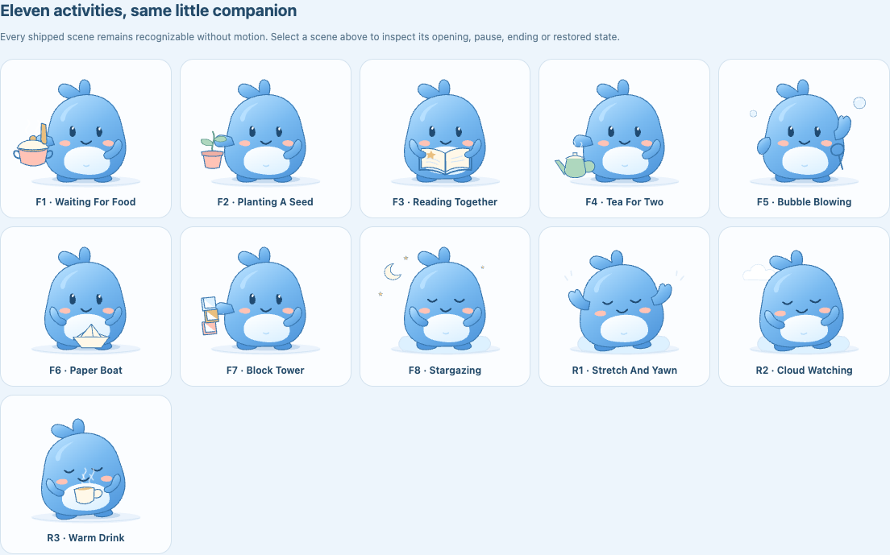

# Blue companion touch interaction — 2026-10-29

## Scope and integration

Baseline: `fb3f77f` (`Document animation and main logic workstreams`). Work is on
`codex/blue-companion-touch` in a separate checkout. Claude's main-logic work in
the original checkout is not included. No merge to main, push or deployment is
part of this increment.

The original blue creature responds to a head pat, a belly squish and a hand
high-five with happy eyes, expressive arms, a contact ring and a small heart.
Pointer exploration adds a bounded gaze. Only the internal drawing transforms;
the transparent contact surface and the existing native host button stay still.
Reduced motion retains a static smile/heart and the same host action.

Production integration uses the existing, unchanged `BlueCompanion` props:
`presentation: CompanionPresentation` and optional `cueId: string`.
Seven stances and welcome/begin/settle/support cues remain supported. The parent
continues to own the native encouragement button, callbacks, factual feedback,
and single live region. No nested button, tab stop or live announcement is added.

The renderer consumes a concurrent host gesture during direct play so it cannot
replay after the local reaction. Completion is guarded by identity. Both CSS
completion and bounded timers settle motion; hidden/pagehide/blur/resize,
incompatible state, errors and reduced-motion changes cancel it. Scrolling and
pointer cancellation clear a press. A normal touch pointerleave after release
preserves the finite response. Secondary pointers cannot replace the primary
interaction. No pointer capture, preventDefault or synthetic business clicks are
used by production code.

The new C2-P1 contract was observed as uncommitted work in Claude's checkout. This
commit does not depend on or edit it. The integrator can keep the current
renderCharacter slot and pass permitted cue IDs; mapping future thought/rest
contact scenes belongs in a separate integration change.

## Local review

The independent fixture preview is not an application screen and is not added to
the application's build or service worker. It imports the production renderer,
offers state/cue/motion controls, and exercises browser events without any timer,
record or persistence implementation.

From this checkout, with the existing dependencies installed:

```sh
npm run check
BASE_PATH=/clock/ npm run build
BASE_PATH=/clock/ npm run preview -- --host 127.0.0.1 --port 45893
./node_modules/.bin/vite build preview/animation --base=/ --outDir /private/tmp/clock-animation-preview
python3 -m http.server 45894 --bind 127.0.0.1 --directory /private/tmp/clock-animation-preview
```

The fixture's synthetic pointer tests are diagnostics only. They are not claims
of real-device touch or screen-reader verification.

## Verification

Environment: Node 26.12.1, npm 11.20.0, desktop in-app Chromium reporting
`Chrome/156.0.0.0` on macOS. This is desktop testing, not a physical phone.

- Strict TypeScript and 201 tests passed, including deterministic geometry,
  responsive/letterboxed contact mapping, invalid input, bounded gaze and
  presentation cue consumption. Touch timing/radius configuration is validated.
- Production build at `/clock/` passed with 20 precache entries. Dependencies and
  the lockfile are unchanged; no remote artwork or new physics library is used.
- Desktop in-app Chromium production checks at 320/375/430 CSS pixels showed no
  horizontal overflow. The character stayed inside the native action.
- A separate temporary HTML harness loading the final production bundle with
  `html { font-size: 200% }` passed the 320-pixel layout and keyboard checks.
  The test style was confirmed in the actual document on a fresh origin, avoiding
  the service worker's normal navigation fallback. This page is not a source
  artifact or a precache entry.
- All **25 browser fixture checks passed**: three contact regions, stable native
  bounds, touch-up/leave, secondary pointer isolation, repeated taps, state/blur/
  resize cancellation, motion-off cancellation, static expression, timeout
  fallback, cue reuse and zero host intents from pointer-only test events.
- Visually inspected all seven static poses and held head-pat/belly-squish
  responses. Contact/release inspection controls are provided in the preview;
  a recording of every planned shared-surface choreography is still pending.
- Clicking the creature still requested encouragement. Keyboard Enter retained
  focus on the native encouragement action; exactly one live region remained.
- Starting, pausing and keyboard resuming remained immediately usable. A
  short session recorded 13 seconds after excluding the pause; Records showed
  one manual-end entry. Animation did not gate those controls.
- Turning the saved animation preference off preserved touch expression and
  encouragement with an empty visual cue. Navigation returned without replay.
- No console warnings/errors were captured in the checked production flows.

## Countdown companionship follow-up

The user requested visible companionship during countdown. A subsequent
animation-only change adds a 4.8-second subtle breath (1.2% width / 1.5% height
expansion, 0.5 SVG-unit lift), synchronized 2-degree hand movements and the
existing 6.8-second blink cycle to the focused stance. These are visual timings,
not breathing instructions or health claims. Only internal SVG groups animate.

Ambient selectors explicitly yield to touch and permitted finite cues. This
also avoids CSS specificity keeping an older ambient animation active during
direct play. Reduced-motion settings retain the static focused expression.
No timer, persistence, callback or shared contract changes are included.

Follow-up verification on the same desktop Chromium 156 environment:

- `npm run check`: 201 tests passed; `/clock/` production and fixture builds
  passed, along with the standalone fixture's strict TypeScript check.
- The expanded browser fixture passed **30/30 checks**, including a continuously
  advancing breath across rerenders, ambient suspension during touch, resumption
  after direct play and zero countdown animations with motion off.
- During a real production five-minute countdown, after the start gesture ended,
  computed styles showed `blue-focus-breathe` and `blue-blink`. Successive
  measurements confirmed changing body geometry with identical native button
  bounds. The 375-pixel scene was visually inspected; pause remained immediate.
- No browser console warnings/errors were captured in the fixture checks.

## Remaining work

This increment implements direct character contact, not shared contact with the
start button or timer. Those scenes require main-owned stable anchors. F2 saved
thought choreography, rewards, mementos, final brand/icons and the full A1–A4
acceptance remain pending. The historical PRD/register snapshots were read; the
live Library links could not be fetched and the remote register was not edited.

Physical iPhone/Android, OS reduced-motion changes, real screen-reader listening,
soft keyboard, installed mode, locked-screen and cold offline checks were not
performed for this increment. Desktop layouts and synthetic events do not
substitute for those checks.

## Session scenes: integrated verification

This later increment was explicitly authorized for implementation and full
integration. Earlier sections remain the historical touch/countdown record.
The current change adds all eight focus and three rest scenes from the
[Start Scenes Plan](../plans/START_SCENES_PLAN.md), C2-P2, snapshot v5, retained
scene assignments, independent focus/rest rotation, saved ending tiers and
permanent scene unlocks at 1/3/6/10/15 fully elapsed focus sessions.

All artwork remains original cached rough.js/SVG. No animation runtime was
added. Playwright 1.62.1 is a development-only dependency for repeatable E2E
checks. Main owns time, persistence, unlocks and one live region; animation
completion has no business effect. Unlock claims are scoped to one local
browser dataset, with no cross-device synchronization claim.

### Verified commands and environment

- `npm run check`: strict TypeScript and **284 tests across 24 files passed**.
  Coverage includes scene selection, bag boundaries, simultaneous starts,
  independent rest rotation, v4 migration, corruption recovery, confirmed
  endings, failed writes/retries, atomic two-tab claims, settings merges,
  encouragement-off cues, pure architecture and motion cancellation.
- `./node_modules/.bin/tsc -p preview/animation/tsconfig.json`: passed.
- `BASE_PATH=/clock/ npm run build`: passed. The E2E command also builds and
  tests the app at `/clock/`, including its service worker and offline recovery.
- `SCENE_BROWSER_CHANNEL=chrome SCENE_E2E_OUTPUT=/private/tmp/clock-scenes-e2e npm run test:e2e`:
  **60 app assertions, 30/30 touch checks and 67/67 scene checks passed**.
- Actual desktop browser: **Chrome 156.0.8078.48**, headless on macOS through
  Playwright 1.62.1. Node 26.12.1; npm 11.20.0. Phone widths and reduced motion
  are browser emulation, not physical-device verification.

The browser suite uses fresh isolated profiles and actual built UI actions.
Playwright's clock advances deadline tests; it does not replace application
accounting or issue saved records directly. It verified real pointer contact,
unchanged Start/Pause bounds, pause exclusion, pause/reload/resume identity,
thought-input motion suppression, short and deadline endings, all five unlock
thresholds, next-start introduction, notice claim/reload behavior, starting
during a pending notice, second-tab scene agreement, independent rest scenes,
scene/motion preferences, keyboard activation and cached offline reload.

The fixture uses production components/styles and covers all 11 scenes in
running, paused, ended and restored static states, all food tiers, exact cue
identity, rest cues, timer fallback, input/touch/hide cancellation, consumed-cue
replay prevention, cross-session touch cancellation and explicit greeting waves.

No console errors or uncaught runtime errors were captured in the final run.
The app has no horizontal overflow at 320/375/430 CSS pixels or 200% root text.
The clock and primary control remain inside the viewport width. Enlarged
feedback grows below the SVG, preserving the face and held props; longer pages
can scroll. All 11 static scene compositions, the 375px reading scene and the
200% text layout were visually inspected.



### Repeating the checks

Run `npm ci`, then `npx playwright install chromium` once and `npm run test:e2e`.
On a machine with Chrome installed, `SCENE_BROWSER_CHANNEL=chrome` uses that
browser instead. The script builds both app and fixture, starts temporary local
servers, writes a JSON report and screenshots to a temporary directory, and
closes its browser/servers. `SCENE_E2E_OUTPUT` selects an artifact directory.
The main deployment workflow runs the same E2E suite before publishing Pages.

### Limits and delivery

Physical iPhone/Android, actual mobile soft keyboards, screen-reader listening,
installed-PWA mode and locked-screen alerts remain unverified. The unrelated
backup/restore/clear feature and broader P0 plan remain future work. The tested
source is prepared for the authorized direct-to-main commit; publication and
the GitHub Pages workflow are verified separately after pushing.
