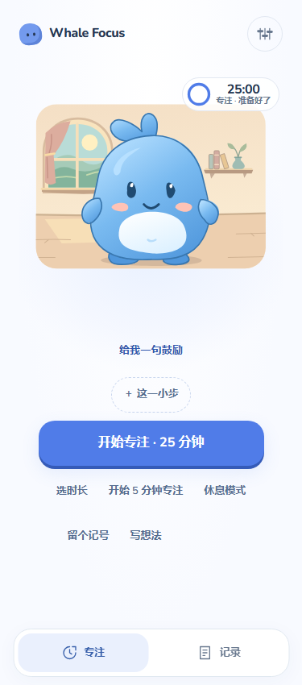
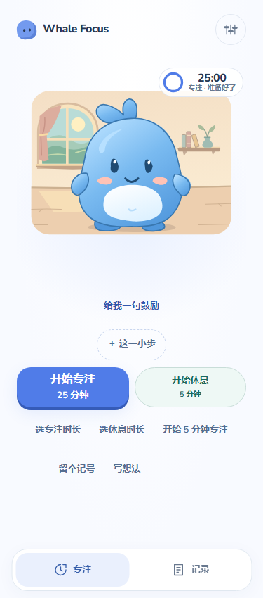

# Focus interaction upgrade

The user supplied **番茄钟_产品PRD_v5.md** on October 31, 2026. This implementation follows §§2.4, 3–7 and 10.7. Its starting commit was `91ef261`, four commits after the PRD archive. The existing orchard artwork, eleven immediately available activities, Records greetings and saved-entry stories are part of the baseline.

## Entry comparison

| Production console, 375 CSS pixels | Action-card comparison, 375 CSS pixels |
| --- | --- |
|  |  |

The comparison page lives under `preview/focus/`. Serve the repository with Vite on a dedicated development origin. Open `/preview/focus/index.html` for the console or append `?layout=cards` for the action cards. Use fresh browser profiles for each trial. Only the console is shipped in the Pages build.

For FQ01, ask someone to prepare 15 minutes without starting, then start a five-minute focus. For FQ03, ask them to leave two markers, add words to the first and write a separate thought. Before each click, record what they expect to happen. Record the first control chosen, any help needed and where they return. Both layouts begin at 25 minutes with the same character. A five-minute-first trial changes a different variable and remains separate.

## State, action and result

| What the user sees | Available action | Observable result |
| --- | --- | --- |
| Ready for focus | Select a duration, start the displayed duration or take the five-minute shortcut | Selecting changes the preview. An explicit start creates one session. A successful change to the focus default or an explicit duration reset replaces earlier one-off choices. |
| Running or paused | Pause, resume, open end confirmation, mark, write or read encouragement | A cancelled end returns to the existing state. Expiry invalidates an old press or confirmation. A keyboard or touch interaction targets the state in which it began. |
| Editing a thought | Continue a draft, add text to a chosen marker, save or close | Opening captures the owner. First nonblank input fixes the creation date. A running timer may expire without moving focus out of the editor. Closing a nonempty draft retains it for later. |
| Competing changes to an edited item | Inspect the latest version or explicitly save the local text as a new thought | An outdated edit cannot silently overwrite another writer or resurrect a deleted item. One recoverable draft is scoped to each dataset generation. |
| End result | Start rest, prepare again or start another focus | Elapsed time reflects the original session. A failed write retains a retry and the option to rest. The result survives a visit to Records or Settings. Cold opening after settlement leaves history available without replaying the event. |
| Rest | Start, pause, resume or end rest | Rest has its own timer and scenes. Its duration contributes zero to focus totals. |
| Reading encouragement | Read, change category, request another phrase or close | Touching the character is a separate action. A pause from another tab or a write problem leaves the requested phrase readable. |
| Records | Switch calendar range, expand a day’s entry, find an older thought or edit in place | The range includes today in the viewing device’s zone. Saved date keys stay fixed. Per-day and range totals sum milliseconds before formatting seconds. Each mode remembers its position for the visit. |

## Verification

The production suites use isolated browser storage. User notes, timings and failure messages in the tests are synthetic.

The release check passed strict TypeScript and 346 tests across 29 files. The Pages build used `/clock/` and generated the service worker with 20 precache entries.

- [Focus interaction checks](../../scripts/verify-focus-interactions.mjs) exercise duration selection, focus return, marker identity, crossing midnight and expiry while editing, a concurrent start, a concurrent pause during requested encouragement, and a failed end write followed by rest and retry. One test delays the lock for note A, types B, fails B's write, types C, then retries. A and B each have one saved entry and C remains the editable draft.
- [Records checks](../../scripts/verify-records-companion.mjs) cover the October 25–31 window, two 600 ms entries totaling one second, older entries outside the total, all-history thoughts, same-page editing and restoring reading position.
- [Scene checks](../../scripts/scene-e2e.mjs) exercise all eleven activities through the production timer, short endings, the fourth full focus, navigation, offline reload, reduced motion and 200% text.
- The [compatibility check](../../scripts/verify-v5-compatibility.mjs) runs the archived v5 decoder and writer against the current store. The current client retains the old active timer and scene. The old client protects newer data on update, missed storage event and cold load.

Desktop Chromium 151.0.7922.34 ran the production flows on Windows. Desktop Edge 156.0.4314.50 also checked stable controls at 320, 375 and 430 CSS pixels with normal and doubled text, and at 800 × 370 in landscape. Those checks used emulated viewports. Physical mobile keyboards, screen-reader sessions and unprompted user trials still need direct observation.

Durable bookmarks, additional permanent reward content, full JSON backup, replacement restore and clear-all remain later P0 work. BD09–BD11 belong to that data-management milestone.
